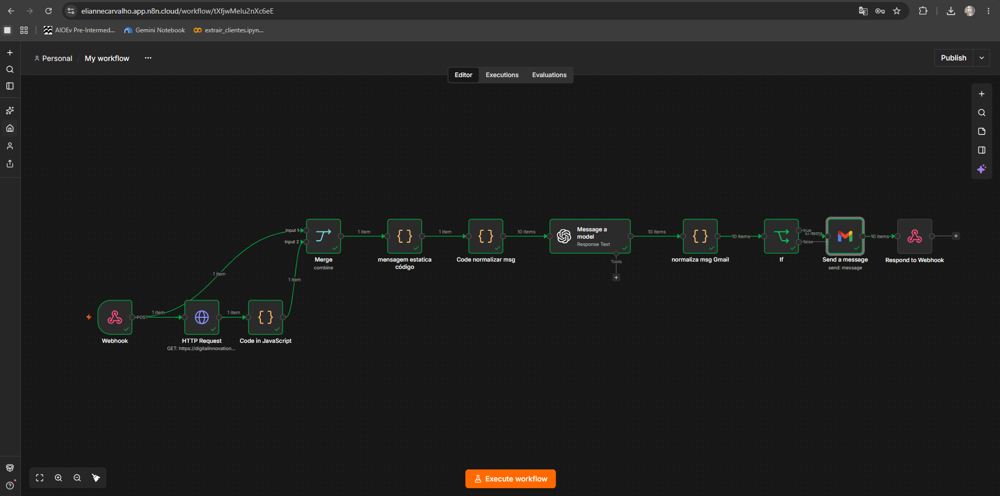

# 🚀 Assistente de Investimentos Automático (RPA + n8n + LLM)

Projeto desenvolvido como solução do desafio da DIO para automação inteligente de recomendações de investimentos e envio de e-mails personalizados.

---

## 🛠️ Arquitetura e Fluxo do Projeto

A solução foi construída integrando Web Scraping, orquestração de fluxos com n8n e Inteligência Artificial Generativa (LLM):

1. **RPA & Web Scraping (Python / Google Colab)**:
   - Extração automática da lista de clientes da aplicação web.
   - Tratamento prévio dos valores numéricos de saldo.
   - Disparo dos dados em lote via requisição HTTP `POST` para o gatilho de **Webhook** do n8n.

2. **Ingestão & Parsing de Dados (n8n)**:
   - Consumo do arquivo `data.csv` contendo as opções de investimento via **HTTP Request**.
   - Normalização dos campos do CSV com JavaScript para o formato JSON estruturado.

3. **Match & Recomendação**:
   - Nó de **Merge/Mesclar** para unificar as bases de clientes e opções de investimentos.
   - Regras de negócio em JavaScript para cruzar o perfil do cliente (`Conservador`, `Moderado`, `Arrojado`) com os limites mínimos de aplicação permitidos pelo saldo do cliente.

4. **Agente de IA Generativa (OpenAI / LLM)**:
   - Geração dinâmica e personalizada de mensagens de abordagem para cada cliente.
   - Retorno estruturado contendo `subject`, `text_body` e `html_body`.

5. **Tratamento, Normalização e Triagem de E-mails**:
   - Ajuste e padronização dos dados no nó `normaliza msg Gmail`.
   - Nó condicional **If** com **Expressão Regular (Regex)** para validar o formato do e-mail do cliente (`to`), separando e-mails válidos para envio de eventuais e-mails mal formatados.

6. **Envio Final (Gmail)**:
   - Encaminhamento automático do e-mail formatado diretamente para a caixa de entrada do cliente via nó do **Gmail**.

---

## 📸 Demonstração do Fluxo no n8n



---

## 💡 Decisões Técnicas de Destaque

- **Robustez na Limpeza do Saldo**: Tratamento em Python e JavaScript para converter moedas em formato de texto (`R$ 12.500,00`) em números do tipo `float` (`12500`), garantindo comparações matemáticas precisas.
- **Processamento em Tabela (Item-by-Item)**: Uso de mapeamentos customizados em JavaScript para transformar payloads únicos de lote em itens individuais no n8n, permitindo que a LLM e o nó de e-mail processem os clientes de forma paralela.
- **Resiliência no Parse do JSON da LLM**: Tratamento regex no nó JavaScript para remover invólucros markdown (```json ... ```) frequentemente retornados por modelos LLM, evitando quebras de pipeline.
- **Validação com Regex no Nó If**: Validação estrita do padrão de e-mail no nó condicional `If` (`matches regex`), garantindo que apenas e-mails sintaticamente corretos sigam para a API do Gmail.

---

## 📂 Estrutura de Arquivos do Repositório

- `n8n/workflow.json`: Exportação JSON completa de todo o fluxo construído no n8n.
- `src/extrair_clientes.ipynb`: Notebook Python executado no Google Colab contendo o script RPA e o envio ao Webhook.
- `docs/fluxo_execucao.png`: Print da execução bem-sucedida do fluxo no canvas do n8n.
